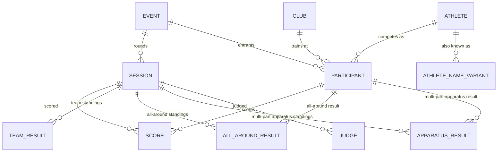

# Design: Elite Gymnastics Data Model

A data repository for elite mens and womens artistic gymnastics competitions and results. The data repository will contain the competitions, the participants and their scores.

This document outlines the data entity models.

## 1. Overview

`Event` is the named competition ("2026 European Championships"). `Session` is a
round within it (Qualification, Team Final, All-Around Final, one Session per
apparatus final). `Participant` is one athlete's entry into the whole `Event` —
bib and NOC are set once per competition. `Score` is the per-apparatus
result within a `Session`.

## 2. Enumerations

Every enum used below is defined once here and referenced by name in the entity
tables, rather than spelled out inline at each use.

Enums that are shown to users carry a `longName` display label (the **Long
Name** column below), exposed through `getLongName()`. Their `find(text)`
matches either the code or the long name, case-insensitively, so an import
file can use either one.

#### `Discipline`

| Value | Description |
|---|---|
| MAG | Men's Artistic Gymnastics |
| WAG | Women's Artistic Gymnastics |

#### `EventLevel`

| Value | Long Name | Description |
|---|---|---|
| OLYMPIC_GAMES | Olympic Games | |
| WORLD_CHAMPIONSHIPS | World Championships | |
| YOUTH_OLYMPIC_GAMES | Youth Olympic Games | |
| CONTINENTAL_GAMES | Continental Games | e.g. Mediterranean Games, Pan American Games |
| CONTINENTAL_CHAMPIONSHIPS | Continental Championships | e.g. European Championships |
| WORLD_CUP | World Cup | |
| WORLD_CHALLENGE_CUP | World Challenge Cup | |
| INTERNATIONAL_TOURNAMENTS | International Tournament | Invitational events with international entries, below World Cup status |
| NATIONAL_CHAMPIONSHIPS | National Championships | A federation's own domestic championship, e.g. US Championships |
| DOMESTIC_COMPETITION | Domestic Competition | Other domestic, non-championship competition |
| UNKNOWN | Unknown | Used instead of leaving `Event.level` null when the tier can't be confidently classified at import time |

#### `Round`

| Value | Long Name | Description |
|---|---|---|
| QUAL | Qualification | Qualification |
| EVENT | Apparatus Final | An Apparatus Final (also called an "Event Final") |
| AA | All-Around Final | All-around final |
| TEAM | Team Final | Team final |

An Apparatus Final is genuinely its own event — its own start list, its own
scores, its own medal ceremony — even though several are typically held on
the same calendar date and, here, share one `EVENT` round value. That
per-apparatus distinction lives on `Session.apparatus` (§3, `Session`)
instead of on a separate `Round` value per apparatus (an earlier revision
of this enum had `FX_FINAL`/`PH_FINAL`/etc.) — matching how `Score` already
carries its own `apparatus` rather than duplicating it onto the round.
`QUAL`/`AA`/`TEAM` cover every apparatus within one session, so
`Session.apparatus` is null for those.

#### `AgeCategory`

| Value | Description |
|---|---|
| SR | Senior |
| JR | Junior, for federations that don't subdivide further |
| JR16 | Junior, age-16 division — used by federations that subdivide (e.g. USA Gymnastics' domestic championships) |
| JR17 | Junior, age-17 division |

#### `Apparatus`

| Value | Long Name | Description |
|---|---|---|
| VT | Vault | Vault |
| UB | Uneven Bars | Uneven bars (WAG) |
| BB | Balance Beam | Balance beam (WAG) |
| FX | Floor Exercise | Floor exercise |
| PH | Pommel Horse | Pommel horse (MAG) |
| SR | Still Rings | Still rings (MAG) |
| PB | Parallel Bars | Parallel bars (MAG) |
| HB | Horizontal Bar | Horizontal/high bar (MAG) |

No `AA` value — all-around is a computed summary (`AllAroundResult`, §5.2), not a
judged apparatus result. (`Round.AA` is a different enum for the All-Around
Final round itself — the two `AA`s aren't related beyond sharing a name.)

#### `ScoreStatus`

| Value | Long Name | Description |
|---|---|---|
| COMPLETED | Completed | The attempt was performed and scored normally. |
| DNS | Did Not Start | The athlete did not start / did not perform this apparatus. |
| INVALID_VAULT | Invalid Vault | The vault attempt was performed but ruled invalid (e.g. a board or landing-zone violation) and received no scored result. Applies to vault attempts only. |
| UNKNOWN | Unknown | |

#### `QualificationResult`

| Value | Long Name | Description |
|---|---|---|
| Q | Qualified | Qualified to the next round. |
| R1 | First Reserve | First reserve. Would advance if a qualified athlete withdraws. |
| R2 | Second Reserve | Second reserve. |
| R3 | Third Reserve | Third reserve. |
| R4 | Fourth Reserve | Fourth reserve (e.g. World Championships All-Around qualification). |
| NR | NOC Reserve | Had a score to qualify, but removed because of maximum of two per country in a final rule. "NOC Reserve" is FIG's own legend wording. |

#### `Country`

No enumerator or type will be used. Countries are the three-letter **IOC codes** World Gymnastics uses (`GER`, `NED`, `CRO`) — not ISO-3166 (`DEU`, `NLD`, `HRV`) — for both NOCs and an event's host country. At times, there will be FIG neutral athletes who are not associated with a country for the competition; they're published under a placeholder code, which can be four characters (`AIN1`, `AIN2` — Individual Neutral Athletes — at the 2026 Cottbus World Cup; `WG2` at the 2026 Europeans), so `Participant.noc` and `TeamResult.noc` accept 3–4 characters.

#### `JudgeFunction`

| Value | Long Name | Description |
|---|---|---|
| PRESIDENT | President | Superior Jury |
| VICE_PRESIDENT | Vice President | Superior Jury |
| MEMBER | Member | Superior Jury |
| D1 | Difficulty Judge 1 | |
| D2 | Difficulty Judge 2 | |
| E1–E7 | Execution Judge 1–7 | One constant per execution judge, `E1` through `E7` |
| L | Line Judge | A panel's only line judge |
| L1 | Line Judge 1 | |
| L2 | Line Judge 2 | |
| T | Time Judge | A panel's only time judge |
| T1 | Time Judge 1 | |
| T2 | Time Judge 2 | |
| SV | Supervisor | Apparatus supervisor |
| DS1 | Difficulty Supervisor | The supervisor on a World Cup apparatus panel (2 D judges, 5 E judges, 1 supervisor), whose D-score the Superior Jury compares against the D-panel's |
| R | Reserve Judge | A single reserve the source doesn't number |
| R1–R6 | Reserve Judge 1–6 | Numbered reserve judges, `R1` through `R6` |

Codes as written in the `*-JUDGES.csv` files. When matching a code,
`JudgeFunction.find` also treats spaces and hyphens as underscores (e.g.
"Vice-President" → `VICE_PRESIDENT`). The unnumbered `L`/`T`/`R` forms are
used when the source lists only one of that role without a number. The
`L`, `T` and `SV` meanings were
confirmed by the 2026 World Championships Judges Assignments, which spell
them out ("Line Judge 1", "Time Judge", "Floor Exercise Supervisor").

## 3. Entities

### `Athlete`

| Field | Type | Nullable | Description |
|---|---|---|---|
| id | Long | No | Generated primary key. |
| licenseNumber | String | Yes | FIG license number assigned registered to athletes. |
| discipline | Discipline | No | The type of gymnastics program this athlete competes in. |
| surname | String | No | Athlete's family name, in written form ("Blakely", "McDonald", "van Pol") whatever capitalisation the source printed — FIG's capitalised surnames are converted by `PersonName`. |
| givenName | String | No | Athlete's given name, in the same written form. |
| birthplace | String | Yes | Where the athlete was born, when the source publishes it (rarely). A further way to tell apart athletes with the same name. |
| birthYear | Short | Yes | Birth year of the athlete — taken from `birthDate` when the source publishes a full date, otherwise from the year the source prints. Null when the source publishes neither (e.g. US Championships). |
| birthDate | Date | Yes | Birth date of the athlete, when the source publishes a full date. |

Unique key: `(surname, given_name, discipline)`. Neither `licenseNumber`
nor `birthYear` is part of it, since both can be null: athletes who only
compete nationally may have no FIG license (one is needed only for
international competition), and national results often publish no birth
year. Two different athletes with the same name in the same discipline
can't both be stored — none exist in the data so far. The athlete's country isn't stored here either; it's `Participant.noc`,
recorded per event.

### `AthleteNameVariant`

Additional names by which the athlete has had.

| Field | Type | Nullable | Description |
|---|---|---|---|
| id | Long | No | Generated primary key. |
| athleteId | Long, FK → `Athlete` | No | The athlete this alternate name belongs to. |
| surname | String | No | Family name, as published by the source, in the same written form as `Athlete.surname`. |
| givenName | String | No | Given name, as published by the source. |

Unique key: `(athlete_id, surname, given_name)`.

### `Event`

| Field | Type | Nullable | Description |
|---|---|---|---|
| id | Long | No | Generated primary key. |
| figEventNumber | String | Yes | FIG-assigned event code, when the event is FIG-sanctioned. Null for competitions run entirely by a domestic federation (e.g. a national championship). |
| title | String | No | The event's name, e.g. "2026 European Championships." |
| startDate | LocalDate | No | First day of competition. |
| endDate | LocalDate | No | Last day of competition. |
| city | String | No | Host city. |
| countryCode | Country | No | Host country, as an IOC code (§2, `Country`). Distinct from any athlete's or team's NOC. |
| venue | String | Yes | Venue/arena name, when published. |
| apparatusSuppliers | String | Yes | The equipment manufacturer(s) supplying the apparatus, as published (e.g. `Spieth`). |
| level | EventLevel | No | The competitive tier of this event. Always set — `UNKNOWN` is used instead of leaving this null when the tier can't be confidently classified. |

Unique key: `(title, start_date)`. One `Event` can hold several disciplines'
sessions (the 2026 Worlds' MAG and WAG share one title, date, and FIG event
number), while sub-events published under their own titles (the 2026
Europeans' Senior and Junior championships) are separate `Event`s.

### `Session`

| Field | Type | Nullable | Description |
|---|---|---|---|
| id | Long | No | Generated primary key. |
| eventId | Long, FK → `Event` | No | The event this round belongs to. |
| date | LocalDate | No | The calendar date this round was held. Several `Session`s commonly share the same date without conflict — e.g. multiple apparatus finals held on one day. |
| round | Round | No | The phase of competition this `Session` represents. |
| discipline | Discipline | No | The program competing in this round. Disambiguates same-named rounds across programs — e.g. a WAG `EVENT` session and a MAG `EVENT` session on Floor are different `Session`s (distinguished together with `apparatus`, below). |
| ageCategory | AgeCategory | No | The age division competing in this round. |
| apparatus | Apparatus, nullable | Yes | Which apparatus this session is for. Set when `round` is `EVENT` — an Apparatus Final is its own session per apparatus — and for `QUAL` at an apparatus-format event (a World Cup), where qualification on each apparatus is its own competition with its own day and judges. Null otherwise, since a championship's `QUAL`/`AA`/`TEAM` each cover all apparatus within one session (see `Score.apparatus` for the per-apparatus split of scores within those). |
| part | Integer, nullable | Yes | Which occurrence of this round this session is, for a round split across more than one session — e.g. US Championships' two-day All-Around, where `round` is `AA` on both sessions and `part` is `1` and `2`, respectively. Null means the round as a whole: for the ordinary single-session round that's the only session, and for a split round it's an additional **whole-round session** holding the combined results (see below). |

Unique key: `(event_id, round, discipline, ageCategory, apparatus, part)`,
declared `NULLS NOT DISTINCT`. A standard SQL unique constraint treats two
nulls as different values, and nearly every session has a null `apparatus`
or `part`, so without it the key would never reject a duplicate.
`NULLS NOT DISTINCT` can't be expressed in a JPA annotation, so it lives
only in the Flyway migration. `SessionService.createSession` also checks
for a duplicate, to report it as a conflict rather than a SQL error.

**Rounds split into parts.** When a round is contested over several sessions
and decided on the combined total (US Championships: Day 1 + Day 2), it has
one session per part (`part` = 1, 2, …) holding the judged `Score`s and each
day's `AllAroundResult`, plus one whole-round session (`part` null) holding the
combined standings: an `AllAroundResult` per athlete for the combined
all-around and an `ApparatusResult` (§5.3) per athlete per apparatus for the
combined apparatus standings. The whole-round session holds no `Score`s of its
own. Its `date` is the first part's date, since it covers several days.

### `Judge`

| Field | Type | Nullable | Description |
|---|---|---|---|
| id | Long | No | Generated primary key. |
| sessionId | Long, FK → `Session` | No | The session this judge served on. |
| apparatus | Apparatus | Yes | Which apparatus this judge is assigned to within the session. Null for a session-wide role (e.g. Superior Jury `PRESIDENT`/`MEMBER`) rather than a per-apparatus panel seat. |
| function | JudgeFunction | No | The judge's role on the panel. |
| givenName | String | No | Judge's given name, as published by the source. |
| surname | String | No | Judge's family name, in the same written form as `Athlete.surname`. |
| nocCode | String | Yes | The federation/NOC this judge is credited to. Not always a 3-letter IOC code — a continental union appointing a Superior Jury (e.g. `EG` for European Gymnastics) or a neutral code (`AIN1`) is credited here too, so no fixed length is enforced. Null when the source credits the official to no federation (e.g. the 2026 Worlds Superior Jury). |

Unique key: `(session_id, apparatus, function, surname, givenName)`. Not
simply `(session_id, apparatus, function)`, since a single function can be
held by more than one judge in the same session with no apparatus to
further distinguish them — e.g. a `QUAL` session's Superior Jury typically
has several `MEMBER` judges. Declared `NULLS NOT DISTINCT`, like `Session`'s
key, so that a session-wide role (null `apparatus`) can't be duplicated.

### `Club`

A gym or club an athlete trains with. Only national-level competitions
(e.g. US Championships) publish it; at best it's tracked at that level.

| Field | Type | Nullable | Description |
|---|---|---|---|
| id | Long | No | Generated primary key. |
| name | String | No | The club's name, as published. |
| country | Country | No | The country the club is in — the NOC of the national competition it was published by. |

Unique key: `(name, country_code)`.

### `Participant`

| Field | Type | Nullable | Description |
|---|---|---|---|
| id | Long | No | Generated primary key. |
| eventId | Long, FK → `Event` | No | The event this entry belongs to. |
| athleteId | Long, FK → `Athlete` | No | The athlete competing. |
| bibNumber | String | Yes | Competition bib/start number, when assigned. |
| noc | Country | No | Who this athlete is competing for at this event. Recorded per event rather than on `Athlete`, since an athlete can change federation or compete as a neutral athlete. |
| clubId | Long, FK → `Club` | Yes | The club the athlete represented at this event. Held per entry rather than on `Athlete`, since an athlete can change clubs between events. Null when the source doesn't publish one — international results identify athletes by country only. |

Unique key: `(event_id, athlete_id)`

### `Score`

One athlete's result on one apparatus in one `Session`. The judged
performance itself lives in an embedded [`Routine`](#routine-embedded) — one for
every apparatus, plus a second only for a vault entry with two attempts — while
the fields directly on `Score` describe the result and its rankings.

| Field | Type | Nullable | Description |
|---|---|---|---|
| id | Long | No | Generated primary key. |
| participantId | Long, FK → `Participant` | No | The athlete this score belongs to. |
| sessionId | Long, FK → `Session` | No | The round this score was earned in. |
| apparatus | Apparatus | No | Which apparatus this row scores. One row per apparatus per `Session`, always — vault's second attempt is `secondRoutine` on this same row, not a second apparatus value (§4). |
| routine | Routine | No | The routine performed — for vault, the first attempt. Its `score` is what counts toward team and all-around results. Columns: `difficulty`, `difficulty_inquiry`, `execution`, `bonus`, `bonus_detail`, `penalty`, `sj_penalty`, `score`, `status_code`. |
| secondRoutine | Routine | Yes | Vault's second attempt. Null means no second attempt was expected at all (the athlete only vaulted once); a second attempt that was expected but not performed is a `Routine` with status `DNS`. Same columns as `routine`, prefixed `second_`. |
| combinedBonus | Double | Yes | A bonus applied to the combined two-vault result rather than to either attempt (e.g. WAG's +0.2). Null otherwise. |
| totalScore | Double | Yes | The result the apparatus final is decided on. For a two-vault entry, the combined result as published (the attempts' average plus `combinedBonus`); otherwise equal to `routine.score`. Null when there's no valid result (e.g. the first vault or an expected second vault was `DNS`). |
| rank | Integer | Yes | Published placement on this apparatus within this `Session`, ranked on `routine.score` — for vault in qualification, the single-vault list ranking the whole field. In an apparatus final, the final's own placement. Where a session's only published vault ranking is a two-vault list (US Championships' Day 1 vault event; World Cup vault qualification, where every vaulter performs two vaults and there is no all-around), it's that ranking, on `totalScore`, and null for single-vault entrants. Null where the source publishes no per-session placement (US Championships Day 2). Copied as published, including tie-breaks, never recomputed. |
| qualificationRank | Integer | Yes | Published placement in the ranking that decides qualification to the apparatus final. Set on every `QUAL` row: for vault it's the double-vault list rank (null for single-vault entrants); for every other apparatus — and for World Cup vault, which has only the two-vault ranking — it equals `rank`. Null outside `QUAL`. |
| qualificationResult | QualificationResult | Yes | Outcome of qualifying to the apparatus final, read against `qualificationRank` (not `rank`). The two-per-country rule shows up here as `NR`, never as a changed rank. Only set on `QUAL` `Session`s. |
| countsTowardTeamResult | Boolean | No | Whether this score counts toward its team's `TeamResult` total (§5.1). Only meaningful for a score earned in a `TEAM` (or team-qualification) `Session` — has no bearing on `AllAroundResult` (§5.2), which always uses every one of a participant's apparatus scores regardless of this flag. Defaults to `true`; set to `false` for the score(s) a drop-lowest rule excludes. The results files don't mark those, so the importer works them out from the published team apparatus totals ([import-process.md](import-process.md#checks)). |

Unique key: `(participant_id, session_id, apparatus)`.

#### `Routine` (embedded)

Not an entity — a group of columns embedded in `Score` twice (`routine`,
`secondRoutine`), so every per-attempt field is defined once.

| Field | Type | Nullable | Description |
|---|---|---|---|
| difficulty | Double | Yes | Difficulty (D) score. |
| difficultyInquiry | Boolean | No (`routine`) | Whether the D score was under inquiry — results print it with a leading `!` (e.g. `!5.5`). `false` unless marked. |
| execution | Double | Yes | Execution (E) score. |
| bonus | Double | Yes | Total bonus applied to this routine. See `bonusDetail` for the itemized breakdown. |
| bonusDetail | JSON | Yes | Itemized breakdown backing `bonus`, shaped as `[{ "bonus": 0.0, "description": "" }]`. Exists because bonus rules change between Code of Points cycles and not every bonus point is FIG-standard — domestic MAG meets (US Championships-style) have awarded one-off incentive bonuses (a "difficulty bonus," say) that are real, scored, and reflected in the published total, but specific to that meet/season. Free-text `description` avoids needing a fixed enum of bonus types that can be redefined every quad. |
| penalty | Double | Yes | Penalty/neutral deduction applied to this routine. |
| sjPenalty | Double | Yes | Superior Jury penalty applied to this routine, distinct from `penalty`. |
| score | Double | Yes | This routine's own result. Null when `status` is `DNS`. |
| status | ScoreStatus | No | Whether the routine was completed, not started, or (vault) invalidated. Required whenever the `Routine` exists. |

## 4. Vault: two scored attempts, one row

Vault is the only apparatus where an athlete can post two separately-judged
attempts that combine into one result. Two shapes were considered and set aside
before landing on the one below:

- **Two apparatus rows (`VT1`/`VT2`), no combined row** — simple, but leaves
  nothing representing the combined two-vault result, which is what decides
  qualification to the Vault final (and the result in the Vault final itself).
  Only athletes aiming for the Vault final perform a second vault in
  qualification; everyone else vaults once. All-around and team scores always
  use the first vault alone, so the combined result only matters for the Vault
  final.
- **A `scoreDetail` JSON array** of attempt breakdowns — no wasted columns, but
  it pushes even the ordinary single-attempt case (every other apparatus, and
  most vault entries) behind a JSON lookup for what's normally a plain, commonly
  queried column.

**Settled on: a second embedded `Routine` on the same row** — null on every row
except a vault entry where a second attempt was expected. Those columns sit
empty for every other row, but the data stays visible as plain columns rather
than needing a JSON reach-in, and every apparatus's result — vaulted once,
vaulted twice, or not vaulted at all — is exactly one `Score` row.

In qualification, one vault row carries two different rankings over the same
attempts:

| Ranking | Ranked on | Who's in it | Stored in |
|---|---|---|---|
| Apparatus (single-vault list) | First vault | The whole field | `rank` |
| Vault-final qualification (double-vault list) | Combined result | Two-vault entrants only | `qualificationRank`, `qualificationResult` |

A single-vault entry and an ordinary beam score look identical in shape:

| apparatus | routine.difficulty | routine.execution | routine.score | secondRoutine | totalScore | rank | qualificationRank |
|---|---|---|---|---|---|---|---|
| BB | 5.8 | 8.200 | 14.000 | null | 14.000 | 1 | 1 |
| VT (one vault) | 5.0 | 9.033 | 14.033 | null | 14.033 | 4 | null |

A two-vault entry populates both routines. `totalScore` is the combined number
as published — the average of the two attempts (truncated to three decimals)
plus any `combinedBonus`. It's stored rather than recomputed because what earns
a combined bonus, and how the combination works, is set by the Code of Points
and changes between quads. The published number is authoritative. Taken from
the 2026 Europeans WAG qualification (KALMYKOVA Anna), where the first vault was
the best in the field but the combined result placed third among two-vault
entrants:

| routine.score | secondRoutine.score | combinedBonus | totalScore | rank | qualificationRank | qualificationResult |
|---|---|---|---|---|---|---|
| 14.100 | 13.033 | 0.2 | 13.766 | 1 | 3 | Q |

`difficulty`/`execution` stay per-routine — FIG doesn't publish a combined D or E
for a two-vault result, only combined totals, so there's no meaningful single
number to put anywhere else.

## 5. Derived summary results

Three facts in this model are aggregates rather than judged results in their
own right: a team's total in a `TEAM` (or qualifying) session, an athlete's
all-around total, and — for a round split into parts — an athlete's combined
total on one apparatus across the parts. Both *could* be computed
on read instead of stored — team totals from `Score.routine.score` where
`countsTowardTeamResult` is true, all-around totals by summing a participant's
apparatus `Score.routine.score` values for the session (no drop-lowest rule involved at
all, unlike team scoring). Both use `routine.score`, not `totalScore`: for vault, team
and all-around results count only the first vault, never the two-vault
combined result. Both are stored anyway, for the same reason vault's `totalScore`
isn't independently recomputed from its two attempts (§4): the officially
published number is the source of truth, and a live recomputation isn't
guaranteed to always agree with it — a late correction to one apparatus score, a
rounding difference, or a case where exactly which scores counted toward a team
total doesn't perfectly match reality. Storing the published aggregate directly
avoids depending on that always being right.

This does mean these entities carry a sync risk: if a `Score` gets
corrected after the fact, the corresponding `TeamResult`/`AllAroundResult`/`ApparatusResult` row
doesn't update itself. That's a real operational concern for whatever
imports/corrects data, not something the schema can prevent on its own —
flagged here rather than solved.

### 5.1 `TeamResult`

| Field | Type | Nullable | Description |
|---|---|---|---|
| id | Long | No | Generated primary key. |
| sessionId | Long, FK → `Session` | No | Scoped to a `TEAM` (or, for some formats, `QUAL`) `Session`. |
| noc | Country | No | Which country/team this result is for. Kept simple since org/roster modeling is out of scope (§1). |
| totalScore | Double | Yes | The team's official published total. Null if the team withdrew or was disqualified before a total was posted. |
| rank | Integer | Yes | The team's placement within the `Session`. |
| qualificationResult | QualificationResult | Yes | Outcome of qualifying to the team final, when this `TeamResult` is on a `QUAL` `Session`. |

Unique key: `(session_id, noc)`

### 5.2 `AllAroundResult`

| Field | Type | Nullable | Description |
|---|---|---|---|
| id | Long | No | Generated primary key. |
| participantId | Long, FK → `Participant` | No | The athlete this result is for. |
| sessionId | Long, FK → `Session` | No | The round this all-around total applies to — typically a `QUAL` or `AA` `Session`. For a round split into parts, one result per part session plus the combined result on the whole-round session (§3, `Session`). |
| totalScore | Double | Yes | The athlete's official published all-around total — the sum of their apparatus `Score.routine.score` values for this `Session` (for vault, the first vault only); on a whole-round session, the published combined total across the parts. Null if the athlete didn't complete every apparatus (most formats require completing all apparatus to receive an all-around result at all — US Championships is an exception and prints a partial total, which is stored as published). |
| rank | Integer | Yes | The athlete's all-around placement within the `Session`. |
| qualificationResult | QualificationResult | Yes | Outcome of qualifying to the all-around final, when this `AllAroundResult` is on a `QUAL` `Session`. |

Unique key: `(participant_id, session_id)`

### 5.3 `ApparatusResult`

An athlete's combined result on one apparatus across a round split into parts
(US Championships' two-day apparatus standings, which decide the apparatus
titles). Not a `Score` — no routine is judged here; the routines are the
`Score`s on each part's session. Only exists on a whole-round session (§3,
`Session`).

| Field | Type | Nullable | Description |
|---|---|---|---|
| id | Long | No | Generated primary key. |
| participantId | Long, FK → `Participant` | No | The athlete this result is for. |
| sessionId | Long, FK → `Session` | No | The whole-round session (`part` null) of a round split into parts. |
| apparatus | Apparatus | No | The apparatus this standing is for. |
| totalScore | Double | Yes | The published combined total: the sum of the athlete's per-part results on this apparatus — for vault, each part's `Score.totalScore` (two-vault result where the athlete contested the vault title). |
| rank | Integer | Yes | Published placement in the combined standings, including tie-breaks. |

Unique key: `(participant_id, session_id, apparatus)`
