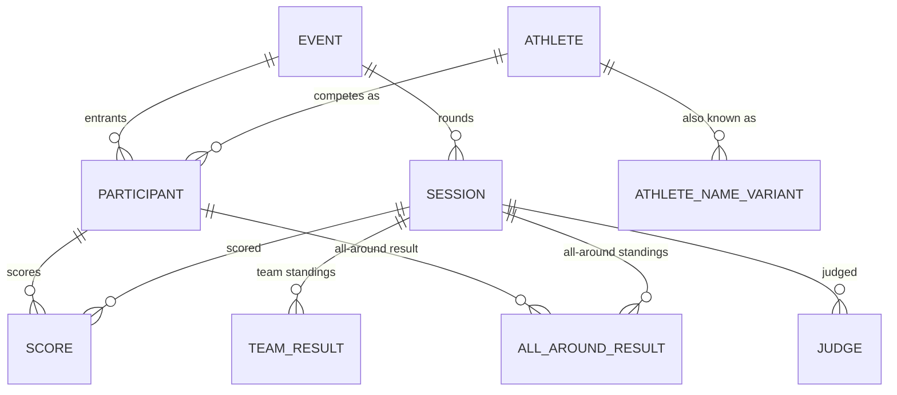

# Design: Elite Gymnastics Data Model

A data repository for elite mens and womens artistic gymnastics competitions and results. The data repository will contain the competitions, the participants and their scores.

This document outlines the data entity models.

## 1. Overview

`Event` is the named competition ("2026 European Championships"). `Session` is a
round within it (Qualification, Team Final, All-Around Final, one Session per
apparatus final). `Participant` is one athlete's entry into the whole `Event` —
bib and NOC are set once per competition. `Score` is the per-apparatus
result within a `Session`.

## 2. Enumerations

Every enum used below is defined once here and referenced by name in the entity
tables, rather than spelled out inline at each use.

#### `Discipline`

| Value | Description |
|---|---|
| MAG | Men's Artistic Gymnastics |
| WAG | Women's Artistic Gymnastics |

#### `EventLevel`

| Value | Description |
|---|---|
| OLYMPIC_GAMES | |
| WORLD_CHAMPIONSHIPS | |
| YOUTH_OLYMPIC_GAMES | |
| CONTINENTAL_GAMES | e.g. Mediterranean Games, Pan American Games |
| CONTINENTAL_CHAMPIONSHIPS | e.g. European Championships |
| WORLD_CUP | |
| WORLD_CHALLENGE_CUP | |
| INTERNATIONAL_TOURNAMENTS | Invitational events with international entries, below World Cup status |
| NATIONAL_CHAMPIONSHIPS | A federation's own domestic championship, e.g. US Championships |
| DOMESTIC_COMPETITION | Other domestic, non-championship competition |
| UNKNOWN | Used instead of leaving `Event.level` null when the tier can't be confidently classified at import time |

#### `Round`

| Value | Description |
|---|---|
| QUAL | Qualification |
| EVENT | An Apparatus Final (also called an "Event Final") |
| AA | All-around final |
| TEAM | Team final |

An Apparatus Final is genuinely its own event — its own start list, its own
scores, its own medal ceremony — even though several are typically held on
the same calendar date and, here, share one `EVENT` round value. That
per-apparatus distinction lives on `Session.apparatus` (§3, `Session`)
instead of on a separate `Round` value per apparatus (an earlier revision
of this enum had `FX_FINAL`/`PH_FINAL`/etc.) — matching how `Score` already
carries its own `apparatus` rather than duplicating it onto the round.
`QUAL`/`AA`/`TEAM` cover every apparatus within one session, so
`Session.apparatus` is null for those.

#### `AgeCategory`

| Value | Description |
|---|---|
| SR | Senior |
| JR | Junior, for federations that don't subdivide further |
| JR16 | Junior, age-16 division — used by federations that subdivide (e.g. USA Gymnastics' domestic championships) |
| JR17 | Junior, age-17 division |

#### `Apparatus`

| Value | Description |
|---|---|
| VT | Vault |
| UB | Uneven bars (WAG) |
| BB | Balance beam (WAG) |
| FX | Floor exercise |
| PH | Pommel horse (MAG) |
| SR | Still rings (MAG) |
| PB | Parallel bars (MAG) |
| HB | Horizontal/high bar (MAG) |

No `AA` value — all-around is a computed summary (`AllAroundResult`, §6.2), not a
judged apparatus result. (`Round.AA` is a different enum for the All-Around
Final round itself — the two `AA`s aren't related beyond sharing a name.)

#### `ScoreStatus`

| Value | Description |
|---|---|
| COMPLETED | The attempt was performed and scored normally. |
| DNS | The athlete did not start / did not perform this apparatus. |
| INVALID_VAULT | The vault attempt was performed but ruled invalid (e.g. a board or landing-zone violation) and received no scored result. Applies to vault attempts only. |

#### `QualificationResult`

| Value | Description |
|---|---|
| Q | Qualified to the next round. |
| R1 | First reserve. Would advance if a qualified athlete withdraws. |
| R2 | Second reserve. |
| R3 | Third reserve. |
| R4 | Fourth reserve (e.g. World Championships All-Around qualification). |
| NR | Had a score to qualify, but removed because of maximum of two per country in a final rule. |

#### `Country`

No enumerator or type will be used. This value is typically the ISO-3166 three-letter country code. At times, there will be FIG neutral-athletes who are not associated with a placeholder country for the competition.

#### `JudgeFunction`

| Value | Description |
|---|---|
| PRESIDENT | |
| VICE_PRESIDENT | |
| MEMBER | |
| D1 | |
| D2 | |
| E1 | |
| E2 | |
| E3 | |
| E4 | |
| E5 | |
| E6 | |
| E7 | |
| L | Line judge. |
| L1 | Line judge 1. |
| L2 | Line judge 2. |
| T | Time judge. |
| T1 | Time judge 1. |
| T2 | Time judge 2. |
| SV | Apparatus supervisor. |
| R1 | First reserve judge. A source listing a single unnumbered reserve is recorded as `R1`. |
| R2 | Second reserve judge. |
| R3 | Third reserve judge. |
| R4 | Fourth reserve judge. |
| R5 | Fifth reserve judge. |
| R6 | Sixth reserve judge. |

Codes as written in the `*-JUDGES.csv` files. `JudgeFunction.find` matches
case-insensitively and treats spaces and hyphens as underscores (e.g.
"Vice-President" → `VICE_PRESIDENT`). The `L`, `T` and `SV` meanings were
confirmed by the 2026 World Championships Judges Assignments, which spell
them out ("Line Judge 1", "Time Judge", "Floor Exercise Supervisor").

## 3. Entities

### `Athlete`

| Field | Type | Nullable | Description |
|---|---|---|---|
| id | Long | No | Generated primary key. |
| licenseNumber | String | Yes | FIG license number assigned registered to athletes. |
| discipline | Discipline | No | The type of gymnastics program this athlete competes in. |
| surname | String | No | Athlete's family name. |
| givenName | String | No | Athlete's given name. |
| country | Country | Yes | The athlete's home/federation country.|
| birthDate | Date | Yes | Birth date of the athlete, when the source publishes a full date. |
| birthYear | Short | Yes | Birth year of the athlete, when the source publishes only a year rather than a full date. Populated only when `birthDate` is null — never redundantly alongside a known `birthDate`. |

### `AthleteNameVariant`

Additional names by which the athlete has had.

| Field | Type | Nullable | Description |
|---|---|---|---|
| id | Long | No | Generated primary key. |
| athleteId | Long, FK → `Athlete` | No | The athlete this alternate name belongs to. |
| surname | String | No | Family name, as published by the source. |
| givenName | String | No | Given name, as published by the source. |

### `Event`

| Field | Type | Nullable | Description |
|---|---|---|---|
| id | Long | No | Generated primary key. |
| figEventNumber | String | Yes | FIG-assigned event code, when the event is FIG-sanctioned. Null for competitions run entirely by a domestic federation (e.g. a national championship). |
| title | String | No | The event's name, e.g. "2026 European Championships." |
| startDate | LocalDate | No | First day of competition. |
| endDate | LocalDate | No | Last day of competition. |
| city | String | No | Host city. |
| countryCode | Country | No | Host country. Distinct from any athlete's or team's NOC. |
| venue | String | Yes | Venue/arena name, when published. |
| level | EventLevel | No | The competitive tier of this event. Always set — `UNKNOWN` is used instead of leaving this null when the tier can't be confidently classified. |

### `Session`

| Field | Type | Nullable | Description |
|---|---|---|---|
| id | Long | No | Generated primary key. |
| eventId | Long, FK → `Event` | No | The event this round belongs to. |
| date | LocalDate | No | The calendar date this round was held. Several `Session`s commonly share the same date without conflict — e.g. multiple apparatus finals held on one day. |
| round | Round | No | The phase of competition this `Session` represents. |
| discipline | Discipline | No | The program competing in this round. Disambiguates same-named rounds across programs — e.g. a WAG `EVENT` session and a MAG `EVENT` session on Floor are different `Session`s (distinguished together with `apparatus`, below). |
| ageCategory | AgeCategory | No | The age division competing in this round. |
| apparatus | Apparatus, nullable | Yes | Which apparatus this session is for. Set only when `round` is `EVENT` — an Apparatus Final is its own session per apparatus. Null for every other round, since `QUAL`/`AA`/`TEAM` each cover all apparatus within one session (see `Score.apparatus` for the per-apparatus split of scores within those). |
| part | Integer, nullable | Yes | Which occurrence of this round this session is, for a round split across more than one session — e.g. US Championships' two-day All-Around, where `round` is `AA` on both sessions and `part` is `1` and `2`, respectively. Null for the ordinary case of a round held in a single session. |

Unique key: `(event_id, round, discipline, ageCategory, apparatus, part)`.
Note this constraint alone does not reliably reject a duplicate session of
any round type, since standard SQL unique constraints don't treat two
nulls as equal, and every real session has at least one of `apparatus`
(non-null only for `EVENT`) or `part` (non-null only for a round split
across sessions) null — the two are never both set at once in practice.
That protection is enforced in application code
(`SessionService.createSession`) instead.

### `Judge`

| Field | Type | Nullable | Description |
|---|---|---|---|
| id | Long | No | Generated primary key. |
| sessionId | Long, FK → `Session` | No | The session this judge served on. |
| apparatus | Apparatus | Yes | Which apparatus this judge is assigned to within the session. Null for a session-wide role (e.g. Superior Jury `PRESIDENT`/`MEMBER`) rather than a per-apparatus panel seat. |
| function | JudgeFunction | No | The judge's role on the panel. |
| givenName | String | No | Judge's given name, as published by the source. |
| surname | String | No | Judge's family name, as published by the source. |
| nocCode | String | No | The federation/NOC this judge is credited to. Not always a 3-letter ISO-3166 country code — a continental union appointing a Superior Jury (e.g. `EG` for European Gymnastics) is credited here too, so no fixed length is enforced. |

Unique key: `(session_id, apparatus, function, surname, givenName)`. Not
simply `(session_id, apparatus, function)`, since a single function can be
held by more than one judge in the same session with no apparatus to
further distinguish them — e.g. a `QUAL` session's Superior Jury typically
has several `MEMBER` judges.

### `Participant`

| Field | Type | Nullable | Description |
|---|---|---|---|
| id | Long | No | Generated primary key. |
| eventId | Long, FK → `Event` | No | The event this entry belongs to. |
| athleteId | Long, FK → `Athlete` | No | The athlete competing. |
| bibNumber | String | Yes | Competition bib/start number, when assigned. |
| noc | Country | No | Who this athlete is competing for at this event. See §7.2 for why this isn't simply read off `Athlete.country`. |

Unique key: `(event_id, athlete_id)`

### `Score`

| Field | Type | Nullable | Description |
|---|---|---|---|
| id | Long | No | Generated primary key. |
| participantId | Long, FK → `Participant` | No | The athlete this score belongs to. |
| sessionId | Long, FK → `Session` | No | The round this score was earned in. |
| apparatus | Apparatus | No | Which apparatus this row scores. One row per apparatus per `Session`, always — vault's second attempt is columns on this same row, not a second apparatus value (§5). |
| totalScore | Double | Yes | The official, ranked result for this apparatus. Equal to `score` when there's one scored attempt; for vault with two attempts, the combined result as published by the source (§5). Null when `status` is `DNS`. |
| difficulty | Double | Yes | Difficulty (D) score of the counting attempt. |
| execution | Double | Yes | Execution (E) score of the counting attempt. |
| penalty | Double | Yes | Penalty/neutral deduction applied to the counting attempt. |
| bonus | Double | Yes | Total bonus applied to the counting attempt. See `bonusDetail` for the itemized breakdown. |
| bonusDetail | JSON | Yes | Itemized breakdown backing `bonus`, shaped as `[{ "bonus": 0.0, "description": "" }]`. Exists because not every bonus point is FIG-standard — domestic MAG meets (US Championships-style) have awarded one-off incentive bonuses (a "difficulty bonus," say) that are real, scored, and reflected in the published total, but specific to that meet/season and never part of the international Code of Points. Free-text `description` avoids needing a fixed enum of bonus types that a federation could redefine every season. |
| score | Double | Yes | The counting attempt's own result, before combining with a second attempt. Equal to `totalScore` except on a two-vault entry. Null when `status` is `DNS`. |
| status | ScoreStatus | No | Whether the counting attempt was completed, not started, or invalidated. |
| secondDifficulty | Double | Yes | Difficulty (D) score of the second vault attempt. Null on every row except a two-vault entry. |
| secondExecution | Double | Yes | Execution (E) score of the second vault attempt. |
| secondPenalty | Double | Yes | Penalty/neutral deduction applied to the second vault attempt. |
| secondBonus | Double | Yes | Total bonus applied to the second vault attempt. |
| secondBonusDetail | JSON | Yes | Itemized breakdown backing `secondBonus`, same shape as `bonusDetail`. |
| secondScore | Double | Yes | The second vault attempt's own result. |
| secondStatus | ScoreStatus | Yes | Status of the second vault attempt. Null means no second attempt occurred at all — distinct from `status`, which is always set. |
| rank | Integer | Yes | Placement for this apparatus within this `Session`. |
| qualificationResult | QualificationResult | Yes | Outcome of qualifying to the next round on this apparatus. Typically only set on `QUAL` `Session`s. |
| countsTowardTeamResult | Boolean | No | Whether this score counts toward its team's `TeamResult` total (§6.1). Only meaningful for a score earned in a `TEAM` (or team-qualification) `Session` — has no bearing on `AllAroundResult` (§6.2), which always uses every one of a participant's apparatus scores regardless of this flag. Defaults to `true`; set to `false` for the score(s) a drop-lowest rule excludes. |

Unique key: `(participant_id, session_id, apparatus)`.

## 4. Vault: two scored attempts, one row

Vault is the only apparatus where an athlete can post two separately-judged
attempts that combine into one official result. Two shapes were considered and
set aside before landing on the one in §4.5:

- **Two apparatus rows (`VT1`/`VT2`), no combined row** — simple, but leaves
  nothing representing the official, ranked, combined result. Most entrants only
  vault once, so the gap only bites two-vault entrants — but that's exactly the
  athletes whose vault result matters most (they're the ones chasing an
  all-around or event-final spot).
- **A `scoreDetail` JSON array** of attempt breakdowns — no wasted columns, but
  it pushes even the ordinary single-attempt case (every other apparatus, and
  most vault entries) behind a JSON lookup for what's normally a plain, commonly
  queried column.

**Settled on: a second, identically-shaped set of columns on the same row** —
null on every row except a two-vault entry. Wasteful in the sense that those
columns sit empty for every non-vault apparatus and every single-vault entry, but
that trade was made deliberately: the data stays visible as plain columns rather
than needing a JSON reach-in, and every apparatus's result — vaulted once,
vaulted twice, or not vaulted at all — is exactly one `Score` row, never
two or three.

A single-vault entry, and an ordinary beam score, look identical in shape (the
`second*` columns simply null):

| apparatus | difficulty | execution | score | secondDifficulty | ... | totalScore | rank |
|---|---|---|---|---|---|---|---|
| BB | 5.8 | 8.200 | 14.000 | — | — | 14.000 | 1 |
| VT (one vault) | 5.0 | 9.033 | 14.033 | — | — | 14.033 | 4 |

A two-vault entry populates both sets, and `totalScore` is the combined number as
published by the source — not independently recomputed by averaging `score` and
`secondScore`, since FIG folds in a connection/vault-value bonus that isn't
cleanly re-derivable from the two attempt scores alone, and a source's own
combined total is authoritative even where it doesn't reconcile to the penny:

| apparatus | difficulty | execution | score | secondDifficulty | secondExecution | secondScore | totalScore | rank |
|---|---|---|---|---|---|---|---|---|
| VT | 5.4 | 8.700 | 14.100 | 4.6 | 8.433 | 13.033 | 13.766 | 3 |

`difficulty`/`execution` (and their `second*` counterparts) stay per-attempt —
FIG doesn't publish a combined D or E for a two-vault result, only combined
totals, so there's no meaningful single number to put anywhere else.

## 5. Derived summary results

Two facts in this model are aggregates over `Score` rows rather than
judged results in their own right: a team's total in a `TEAM` (or
qualifying) session, and an athlete's all-around total. Both *could* be computed
on read instead of stored — team totals from `Score.totalScore` where
`countsTowardTeamResult` is true, all-around totals by summing a participant's
apparatus totals for the session (no drop-lowest rule involved at all, unlike
team scoring). Both are stored anyway, for the same reason vault's `totalScore`
isn't independently recomputed from its two attempts (§5): the officially
published number is the source of truth, and a live recomputation isn't
guaranteed to always agree with it — a late correction to one apparatus score, a
rounding difference, or a case where exactly which scores counted toward a team
total doesn't perfectly match reality. Storing the published aggregate directly
avoids depending on that always being right.

This does mean both entities carry a sync risk: if a `Score` gets
corrected after the fact, the corresponding `TeamResult`/`AllAroundResult` row
doesn't update itself. That's a real operational concern for whatever
imports/corrects data, not something the schema can prevent on its own —
flagged here rather than solved.

### 5.1 `TeamResult`

| Field | Type | Nullable | Description |
|---|---|---|---|
| id | Long | No | Generated primary key. |
| sessionId | Long, FK → `Session` | No | Scoped to a `TEAM` (or, for some formats, `QUAL`) `Session`. |
| noc | Country | No | Which country/team this result is for. Kept simple since org/roster modeling is out of scope (§1). |
| totalScore | Double | Yes | The team's official published total. Null if the team withdrew or was disqualified before a total was posted. |
| rank | Integer | Yes | The team's placement within the `Session`. |
| qualificationResult | QualificationResult | Yes | Outcome of qualifying to the team final, when this `TeamResult` is on a `QUAL` `Session`. |

Unique key: `(session_id, noc)`

### 5.2 `AllAroundResult`

| Field | Type | Nullable | Description |
|---|---|---|---|
| id | Long | No | Generated primary key. |
| participantId | Long, FK → `Participant` | No | The athlete this result is for. |
| sessionId | Long, FK → `Session` | No | The round this all-around total applies to — typically a `QUAL` or `AA` `Session`. |
| totalScore | Double | Yes | The athlete's official published all-around total — the sum of their apparatus `Score.totalScore` rows for this `Session`. Null if the athlete didn't complete every apparatus (most formats require completing all apparatus to receive an all-around result at all). |
| rank | Integer | Yes | The athlete's all-around placement within the `Session`. |
| qualificationResult | QualificationResult | Yes | Outcome of qualifying to the all-around final, when this `AllAroundResult` is on a `QUAL` `Session`. |

Unique key: `(participant_id, session_id)`
